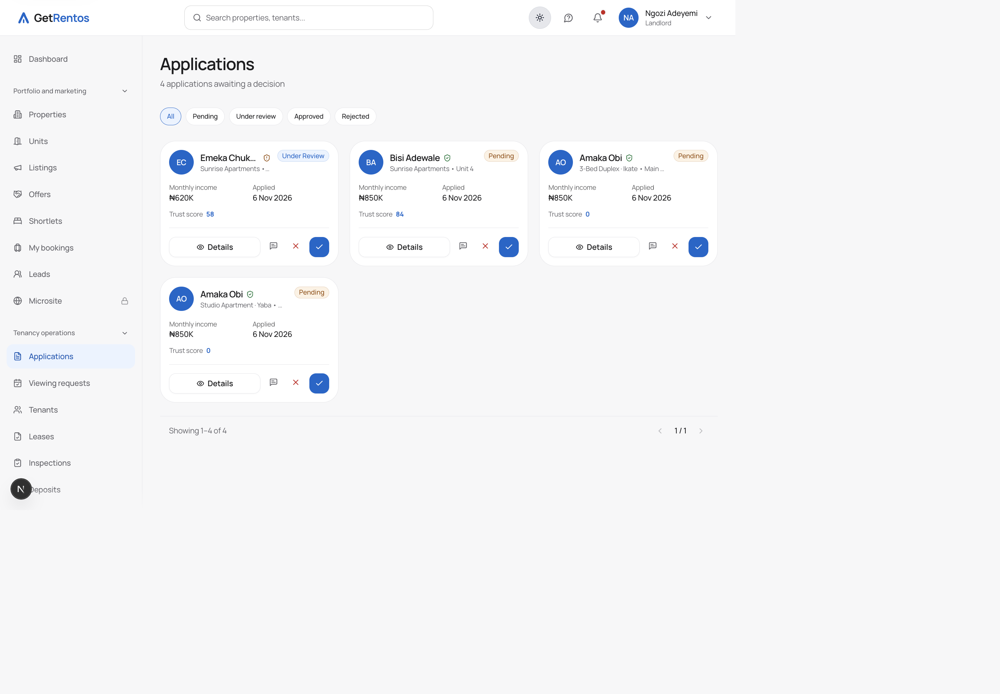
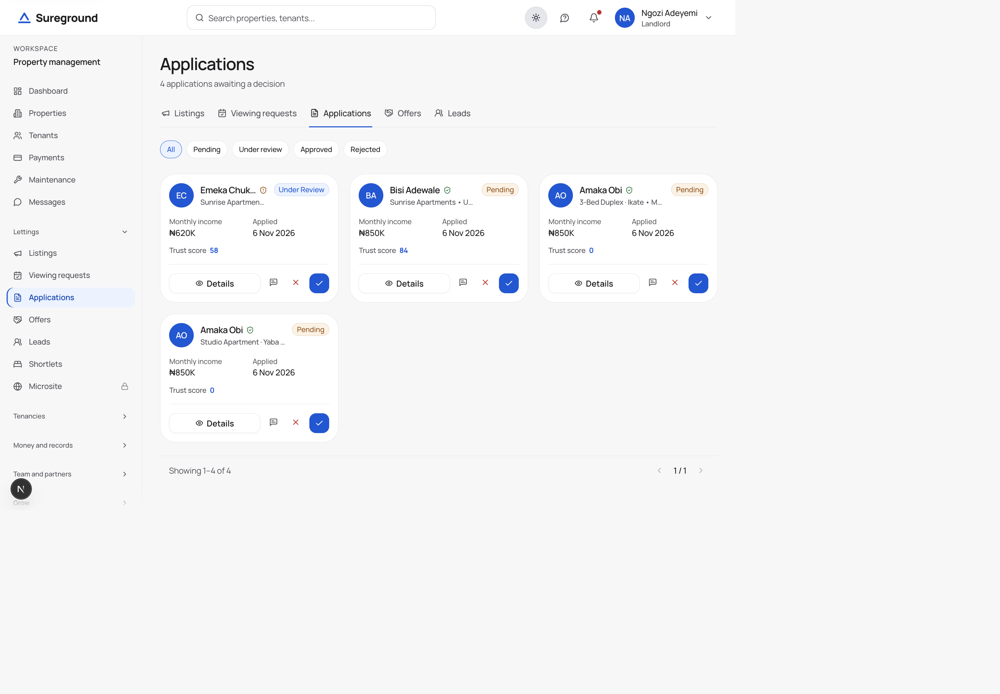

# Navigation and sidebar redesign: implementation report

Brief: "World-class enterprise navigation and sidebar transformation" (2026-11-07).
Work by Codex (2026-11-07 to 08) and Claude sessions (2026-11-09). Everything listed
here is on `dev`. Results are from runs in the VS Code browser bridge against the
local web app (`localhost:3000`) and API (`localhost:4000`), unless marked otherwise.
Nothing here has been through CI: GitHub Actions is blocked by account billing.

## 1. Audit of the navigation before the redesign

What made the sidebar feel busy, found by reading every role's sidebar, top bar
and account menu and by opening them in the browser:

| #   | Problem                                                     | Where                                                                                                                                                                                       | Evidence                                                                                                                                                                         |
| --- | ----------------------------------------------------------- | ------------------------------------------------------------------------------------------------------------------------------------------------------------------------------------------- | -------------------------------------------------------------------------------------------------------------------------------------------------------------------------------- |
| 1   | Too many first-level items                                  | Landlord (34), owner (29), estate (26)                                                                                                                                                      | Every item shown, all at the same level                                                                                                                                          |
| 2   | Groups that did not match their labels                      | Owner, estate, agent, realtor, buyer                                                                                                                                                        | Groups were positional slices of one list; owner "Communication" held Approvals and Documents; estate code carried comments warning that every insert shifts the groups after it |
| 3   | Groups mixing unrelated jobs                                | Landlord "Finance and compliance" (activity, questions, documents, Managed); owner "Sales and investment" (selling plus home management, vendors, inspections, deposits)                    | Group contents                                                                                                                                                                   |
| 4   | Same destination in two or three places                     | Account menus repeated sidebar pages (landlord/owner Properties, realtor Clients, agent Tasks, buyer Saved, estate Households); tablet-only top-bar links repeated Dashboard and Properties | Route audit of sidebar, top bar and account menu per role                                                                                                                        |
| 5   | Duplicate icons for different pages                         | Landlord (Approvals/Verification, Listings/Automations), owner (Transactions/Approvals/Verification, Trust profile/Billing, Properties/Estate requests), estate (Incidents/Emergency)       | Icon audit                                                                                                                                                                       |
| 6   | Unnecessary scrolling                                       | Desktop rows were 44px (touch size) on a mouse-only sidebar                                                                                                                                 | Landlord sidebar fully expanded: 2,177px                                                                                                                                         |
| 7   | No way to reach most pages on tablets                       | Every role, 640 to 1023px                                                                                                                                                                   | At 820px the top bar overflowed and pushed the menu button off screen; the sidebar is desktop-only and the bottom bar was phone-only                                             |
| 8   | Phone bar dropped Messages                                  | Landlord, owner, renter, agent                                                                                                                                                              | Bar took the first five primary links; Messages was sixth. The native app has Messages on every role's tab bar                                                                   |
| 9   | Workflows reachable only through the sidebar                | Lettings and sales pipelines                                                                                                                                                                | No way to step Listings → Viewings → Applications → Offers without the sidebar                                                                                                   |
| 10  | Inconsistent "back" on detail pages                         | Agency, land conveyance, handover                                                                                                                                                           | Each page had its own arrow link, or none                                                                                                                                        |
| 11  | Drawer not dismissible by keyboard                          | All roles                                                                                                                                                                                   | Escape did nothing; focus did not return to the menu button; the page showed through underneath                                                                                  |
| 12  | Pages without a heading                                     | Landlord Automations and estate Microsite upgrade screens; renter Trust score tab                                                                                                           | No h1 for screen readers                                                                                                                                                         |
| 13  | Long labels cut off                                         | Pidgin (`pcm`)                                                                                                                                                                              | "Make Sureground manage am" needs 187px of 180px                                                                                                                                 |
| 14  | Animations ignored reduced motion                           | Menu drawer and other Framer Motion animations                                                                                                                                              | The CSS reduced-motion rule does not reach JavaScript animations                                                                                                                 |
| 15  | Eight near-copies of the top bar (fixed for five, 39b895cd) | All web roles                                                                                                                                                                               | Same logo, search, bell, account menu and drawer code in each role                                                                                                               |

"Before" screenshots were not saved at the start. See section 4.

## 2. Route and role matrix

Every link in each role's sidebar was opened at its own URL. Each check passed only if the
page loaded at that URL, exactly one sidebar link was current and was that page, the
link's group was open, the page had one h1, and there were no console errors (Next.js
dev overlay messages excluded).

| Role                                 | Account                                                                     |                                                                                                                                                                                                                                                                            Sidebar pages | Result       |
| ------------------------------------ | --------------------------------------------------------------------------- | ---------------------------------------------------------------------------------------------------------------------------------------------------------------------------------------------------------------------------------------------------------------------------------------: | ------------ |
| Landlord                             | seed-landlord                                                               |                                                                                                                                                                                                                                                                                       34 | All pass     |
| Property owner                       | seed-owner                                                                  |                                                                                                                                                                                                                                                                                       29 | All pass     |
| Renter                               | seed-renter                                                                 |                                                                                                                                                                                                                                                                                       16 | All pass     |
| Realtor                              | seed-realtor                                                                |                                                                                                                                                                                                                                                                                       16 | All pass     |
| Field agent                          | aisha.suleiman.test                                                         |                                                                                                                                                                                                                                                                                       14 | All pass     |
| Buyer                                | seed-buyer                                                                  |                                                                                                                                                                                                                                                                                       15 | All pass     |
| Estate manager                       | qa-audit-estate                                                             |                                                                                                                                                                                                                                                                                       26 | All pass     |
| Backoffice (61 pages, by permission) | Dashboard, Users, Verifications, Unmatched Payments, Disputes, Fraud & Risk | Reports · People and identity · Properties and listings · Managed services · Payments in · Payouts and ledgers · Land · Risk and disputes · Communications · Platform (89c728bb: the groups had drifted, with payments under "Marketplace operations" and land under "Risk and finance") |
| **Total**                            |                                                                             |                                                                                                                                                                                                                                                                                  **150** | **All pass** |

The run found and fixed:

- Verification pages returned 500 for every role: `@smileid/web-sdk` was declared but not installed. Fixed with `pnpm install --frozen-lockfile`; no code change.
- Three pages had no heading (section 7).

Some runs failed for test-harness reasons: the browser panel lost focus, or one request
failed in the CORS workaround. Every affected page was re-run until it gave a clean result.

Backoffice: 61 sidebar pages, signed in as `qa-audit-staff-backoffice-admin` (two-factor). 58 passed first time; `/admin/managed-mandates` passed on re-run. Fixed in 92c22e5c:

- `/admin/rentals/units` marked two links current (Rentals and Units & Tenants).
- Pressing Enter on the sign-in code step re-ran the password step instead of verifying the code.
- The top bar repeated Dashboard and Users.
  All three fixes were re-checked in the browser:
- Enter on the code step signs in with a single `/auth/login` call.
- `/admin/rentals/units` has one current link.
- The top bar shows only the logo.

`/admin/escrow` loads normally with the panel visible; its earlier "Loading page…" came from the hidden browser tab, not the app.

## 3. Information architecture

One shared structure for every role (`createRoleNavigation` in
`apps/web/components/shared/dashboard/GroupedSidebar.tsx`):

1. **Workspace identity:** the workspace name at the top (for example "Property management" or the estate name).
2. **Primary:** six destinations, always visible and never folded.
3. **Contextual:** the rest, in groups named after the job, folded until opened. The group holding the current page is always open, and the open/closed state is remembered per workspace.
4. **Utility:** "Account and preferences" at the foot (settings, billing, verification, own stays).
5. **Account menu** (top bar): profile, role switching, security, help and sign out only. No product pages.

Groups are picked by route (`pick(...)`) in owner, estate, realtor and buyer, so a group
cannot drift from its label when items are added. Agent and renter still use list slices;
their labels match their contents.

| Role        | Primary                                                                     | Contextual groups                                                                            |
| ----------- | --------------------------------------------------------------------------- | -------------------------------------------------------------------------------------------- |
| Landlord    | Dashboard, Properties, Tenants, Payments, Maintenance, Messages             | Lettings · Tenancies · Money and records · Team and partners · Grow                          |
| Owner       | Dashboard, Properties, Sale listings, Offers, Transactions, Messages        | Selling · Land · Short stays · Property care · Money and records · Managers and partners     |
| Renter      | Dashboard, Find a home, Your tenancy, Payments, Maintenance, Messages       | Unchanged                                                                                    |
| Realtor     | Dashboard, Listings, Clients, Leads, Offers, Messages                       | Clients and listings · Deals and commissions · Messages and documents · Professional profile |
| Field agent | Dashboard, Tasks, Inspections, Verifications, Work orders, Messages         | Field operations · Messages and documents · Trust and account                                |
| Buyer       | Dashboard, Discover, Saved, Offers, Transactions, Messages                  | Find property · Buying · Messages and documents · Trust and account                          |
| Estate      | Dashboard, Households, Visitor passes, Expected today, Incidents, Emergency | Marketplace · Residents · Gate and visitors · Safety · Community · Administration            |

No route was removed, and every link is still reachable; per-role counts were checked by
script after each regroup.

**Phone and tablet (under 1024px):** a bottom bar with the first four primary pages plus
Messages, matching every role's tab bar in the native app, and a menu button opening the
full navigation in a drawer. **Desktop:** the sidebar, which folds to a 72px icon rail
holding the primary pages plus the current page when it is deeper; names show on hover
and focus.

**Contextual navigation:**

- Pipeline tabs (`SectionNav`) on landlord lettings (Listings, Viewing requests, Applications, Offers, Leads) and owner selling (Sale listings, Buyer leads, Viewings, Offers, Transactions).
- Tabbed hubs (`HubTabs`) for pages merged into one (payments, maintenance, financials and others).
- Breadcrumbs on detail pages.

A search box or command palette was not added. With six primary pages and the existing
global search, there is no evidence it is needed.

## 4. Before and after

Landlord, Applications page, 1440px wide, light mode. "Before" is `994aa79c^` (the commit
before the redesign started), run from a separate worktree against the same API and data.
"After" is `dev` after the Sureground rename.

| Before                                             | After                                            |
| -------------------------------------------------- | ------------------------------------------------ |
|  |  |

| Measure                                | Before              | After                                 | How measured                  |
| -------------------------------------- | ------------------- | ------------------------------------- | ----------------------------- |
| Landlord sidebar links visible on load | 34 of 34            | 13 of 34 (6 primary + the open group) | Visible `.sidebar-item` links |
| Landlord sidebar height on load        | 1,924px             | 1,059px                               | `scrollHeight`, 1440px wide   |
| Landlord sidebar, every group opened   | 1,924px             | 1,899px                               | Same, all groups open         |
| Desktop row height                     | 44px                | 36px (44px on touch)                  | `getBoundingClientRect`       |
| Account menus repeating a sidebar page | 6 roles             | 0                                     | Route audit                   |
| Tablet (820px) access to all pages     | None                | Bottom bar + menu                     | Landlord, in the browser      |
| Messages in the phone bar              | Missing for 4 roles | Every role that has it                | Code and browser              |
| Moving along the lettings pipeline     | Sidebar only        | Tabs under the page title             | Screenshots above             |

Also in `screenshots/`: the after version with every group opened (before had nothing folded, so its screenshot is the same as above).

## 5. What changed and why

| Commit             | Change                                                                                                                                             | Why it helps                                                                                                     |
| ------------------ | -------------------------------------------------------------------------------------------------------------------------------------------------- | ---------------------------------------------------------------------------------------------------------------- |
| 994aa79c (Codex)   | Primary / contextual / utility structure for every role                                                                                            | Fewer things to scan; the current section opens itself                                                           |
| 886a0810 (Codex)   | Phone bottom bar                                                                                                                                   | Main pages one tap away on phones                                                                                |
| 0e0dc9ec (Codex)   | Accessible hub tabs; shared `Breadcrumbs`                                                                                                          | Keyboard arrow keys work in tabs; one breadcrumb style                                                           |
| 9d173f93           | Desktop icon rail, remembered per browser                                                                                                          | More room for content without losing the main pages                                                              |
| 6629b643           | Landlord regroup by job; 36px rows; account menus without product pages; tablets get bar + drawer; full-height drawer with Escape and focus return | Clear grouping; less scrolling; one place per destination; tablets usable; keyboard users can dismiss the menu   |
| c2f7406e           | Owner regroup, picked by route; distinct icons; "Messages and documents" label for agent, realtor, buyer                                           | Groups say what they hold and cannot drift                                                                       |
| cede40cf           | Breadcrumbs on agency, conveyance and handover detail pages                                                                                        | Same way back everywhere                                                                                         |
| 03784452           | Pipeline tabs; phone bar keeps Messages                                                                                                            | Step through a pipeline without the sidebar; parity with the native app                                          |
| 69c39ebd, 6fb8d2c2 | Headings on Automations, estate Microsite, renter Trust score                                                                                      | Every page has a name for screen readers                                                                         |
| 78dda860           | Estate regroup, picked by route; 9-item group split                                                                                                | Gate work separate from residents                                                                                |
| 47890df8           | Reduced motion for Framer animations; long labels wrap                                                                                             | Respects the system setting; Pidgin labels readable                                                              |
| 223995f0           | Realtor and buyer follow their priorities                                                                                                          | Messages on both phone bars; commissions and professional verification easy to find for realtors                 |
| 39b895cd           | Landlord, owner, realtor, agent and buyer top bars become thin wrappers over one `WorkspaceNavbar` (705 lines to 434)                              | One place for search, drawer and menu behaviour, so roles cannot drift apart; duplicate Escape listeners removed |

## 6. Responsive validation

The VS Code browser renders at 0.8 zoom, so a 390px screen needs a 312px viewport. Earlier
"stuck at 1,025px" readings were this scaling. Widths below are measured `innerWidth`.

| Role                                    | 390 (phone)                                  | 820 (tablet)                        | 1024        | How                                       |
| --------------------------------------- | -------------------------------------------- | ----------------------------------- | ----------- | ----------------------------------------- |
| Landlord, owner, realtor, buyer, estate | No overflow                                  | No overflow                         | No overflow | Signed in, `scrollWidth − innerWidth` = 0 |
| Agent                                   | Fixed (6dac2be6): menu button was off screen | No overflow                         |             | Same, plus screenshots                    |
| Renter                                  | Fixed (354584bd): menu button off screen     | Fixed: page scrolled 208px sideways | No overflow | Also 768, 900, 1280: no overflow          |

Phone and tablet screenshots: `screenshots/after-agent-phone.png`, `screenshots/after-agent-tablet.png`.
Bottom-bar labels cut off at 390px for long names ("Inspectio…", "Verificati…"); readable via the
accessible name, but shorter labels would help. Browser back with the drawer open (landlord, 390px): returns to the previous page with the drawer
closed. Not tested on a real device: rotation and safe-area insets. Rotation changes only the width,
which the table above covers.

## 7. Accessibility results (target WCAG 2.2 AA)

| Check                     | Result                                                                                                                     |
| ------------------------- | -------------------------------------------------------------------------------------------------------------------------- |
| Landmarks and names       | Sidebar, phone bar, drawer and pipeline tabs are `nav` elements with labels                                                |
| `aria-current`            | Exactly one current link on all 150 matrix pages                                                                           |
| `aria-expanded`           | On every group heading; Enter and Space toggle it (keyboard test)                                                          |
| Skip link                 | First Tab stop; visible when focused; moves focus to `<main>`                                                              |
| Keyboard order (landlord) | 13 sidebar stops: 6 primary, 6 group headings, Collapse. Links in folded groups are skipped                                |
| Focus visible             | Every stop has a ring, except the Next.js dev overlay                                                                      |
| Escape and focus return   | Escape closes the drawer (tested). Focus return is implemented but was not confirmed in the bridge                         |
| Headings                  | Fixed on three pages; one h1 on all 150 matrix pages                                                                       |
| Reduced motion            | CSS animations already respected it; Framer animations now do (`MotionConfig`). Not observed in the browser                |
| Touch targets             | Rows 44px on touch screens; bar items 56px tall                                                                            |
| Contrast                  | Token pairs measured AA in an earlier audit (2026-11-05); text colours changed since (`1bc27cbd`) and were not re-measured |
| Screen reader             | **Not tested** with VoiceOver or NVDA                                                                                      |

## 8. Functional and security regression results

| Check                                                           | Result                                                                           |
| --------------------------------------------------------------- | -------------------------------------------------------------------------------- |
| Deep links, 150 pages, 7 roles                                  | Pass                                                                             |
| Back, forward, reload, query string (estate)                    | Correct link stays current                                                       |
| Another role's page typed into the URL (estate manager tried 7) | Redirected to the user's own home; nothing from the other role shown             |
| Another role's API with a renter token                          | 403 on landlord, owner, buyer, realtor, agent and admin; 200 on the renter's own |
| Group open/closed state after reload                            | Kept (browser test in `tests/browser/design-system.spec.ts`, not run in CI yet)  |
| Role switching, workspace switching                             | **Not tested**                                                                   |
| Dark mode                                                       | Seen working throughout; not systematically compared                             |
| Long labels (Pidgin)                                            | One overflow found and fixed (wraps to two lines); not yet seen in the browser   |

## 9. Files changed (since `994aa79c^`)

31 files in the navigation scope: 1,343 lines added, 343 removed. The main ones:

- `apps/web/components/shared/dashboard/GroupedSidebar.tsx`: structure, rail, phone bar, drawer behaviour.
- `apps/web/components/shared/navigation/{SectionNav,WorkflowNavs,HubTabs,AccountMenu}.tsx`
- `apps/web/components/*/dashboard/*Sidebar.tsx`: every role.
- `apps/web/components/*/navigation/*Navbar.tsx` and `*ProfileDropdown.tsx`
- `packages/ui/src/{Breadcrumbs,SidebarRailToggle}.tsx`, `packages/ui/src/hooks/useSidebarRail.ts`, `packages/ui/src/styles/index.css`, `packages/ui/src/providers/QueryProvider.tsx`
- `apps/backoffice/components/admin/dashboard/AdminSidebar.tsx` (Codex).
- Pages: the ten pipeline pages; detail views using breadcrumbs; Automations, estate Microsite and renter Trust score headings.

## Efficiency and feature flags

**Steps to reach a page (landlord, 1440×1000).** Before the redesign every group started open:
34 links in a 1,924px sidebar, of which the first 15 were visible without scrolling.

| Page                                                                                  | Before                                                                         | After                                                                |
| ------------------------------------------------------------------------------------- | ------------------------------------------------------------------------------ | -------------------------------------------------------------------- |
| The 6 primary pages (Dashboard, Properties, Tenants, Payments, Maintenance, Messages) | 1 click; Payments, Maintenance and Messages were below the fold (scroll first) | 1 click, no scroll                                                   |
| The other 28 pages, first visit                                                       | 1 click for the 15 above the fold, scroll + click for the rest                 | 2 clicks (open the group, then the link)                             |
| The other 28 pages, later visits                                                      | as above                                                                       | 1 click: the group stays open, and opens itself on any page it holds |
| Next step in the lettings pipeline                                                    | back to the sidebar                                                            | 1 click on the tabs under the title                                  |

This is a trade-off, not a uniform reduction: the redesign removes scrolling and puts every
destination in view at a glance, at the cost of one extra click the first time a secondary page is
opened. Counted from the code and the before/after screenshots, not from user sessions.

**Feature-flagged links (land).** With land mode off:

- The owner and buyer sidebars hide the land links.
- Every hidden link sits under a layout wrapped in `LandAvailabilityGate` (`/owner/land/…`, `/buyer/land/…`, `/land/…`), so a typed land address shows "Land is not available yet" instead of a broken page.
- Known flicker (code review): `useLandAvailability` treats land as on until the API answers, so with land off the land links show for a moment, then disappear.

## Performance, resilience, rail, keyboard and dark mode (second pass)

**Performance (landlord, dev server, warmed, 1440px).** Same script on `994aa79c^` (before) and `dev`:

|                                            | Before    | After                                                                                     |
| ------------------------------------------ | --------- | ----------------------------------------------------------------------------------------- |
| Dashboard load, layout shift (CLS)         | 0.002     | 0.001 (a first run read 0.062, all from dashboard content loading, none from the sidebar) |
| Sidebar click to new page heading, 5 pages | 118–154ms | 103–148ms                                                                                 |
| Long tasks during those clicks             | 0         | 0                                                                                         |
| Layout shifts caused by the sidebar        | 0         | 0                                                                                         |

No navigation-related regression. Dev-server timings; production will be faster.

**Resilience.** Every GET a page makes was made to fail in turn (500), and separately slowed by 5s:

- Before the fixes, a failed notification bell, `/me/subscription` (every sidebar reads it), `/estate/mine`, or the page's own data replaced the whole screen with "Something went wrong", top bar and sidebar included.
- Fixed in 8cf3ad86, 40d31bb4 and 75fa3ea8:
  - The bell and plan queries no longer throw.
  - The estate layout shows its own retry.
  - Every web role and the backoffice admin segment have an error boundary inside the layout.
- Re-run: the navigation stays in place for every failure, and page errors show inside the page.
- Slow responses: the navigation rendered at once.

**Rail, keyboard and dark mode, every web role** (real Tab presses):

| Role     | Sidebar Tab stops, all with focus ring | Rail: links, current page, name on focus | Dark-mode lowest contrast |
| -------- | -------------------------------------- | ---------------------------------------- | ------------------------- |
| Landlord | 19                                     | 7, Leases, yes                           | 8.53:1                    |
| Owner    | 18                                     | 7, Vendors, yes                          | 8.53:1                    |
| Renter   | 12                                     | 7, Roommates, yes                        | 8.53:1                    |
| Realtor  | 14                                     | 7, Commissions, yes                      | 8.53:1                    |
| Agent    | 11                                     | 7, Documents, yes                        | 8.53:1                    |
| Buyer    | 12                                     | 7, Documents, yes                        | 8.53:1                    |
| Estate   | 19                                     | 7, Vehicles, yes                         | 8.53:1                    |

The rail is 72px wide in every role. Backoffice rail, keyboard and resilience in the browser: pending
(the VS Code panel was hidden).

## 10. Remaining issues and recommendations

1. **Backoffice:**
   - Done: groups fixed in code (89c728bb), and the test admin `qa-audit-staff-backoffice-admin` now has two-factor.
   - Still to do: open the backoffice in the browser (the sign-in did not submit in the bridge; check by hand); the icon rail; Title Case labels ("Trust Reviews") against the sentence-case rule. Those labels are also lookup keys in the sidebar code, so change them together.
2. **More screenshots:** phone and tablet before-and-after (desktop is in section 4).
3. **Not tested yet:**
   - orientation change
   - workspace switching with two estates
   - screen readers (VoiceOver on Safari, NVDA on Chrome)
4. **Top bars:** five of eight top bars now share `WorkspaceNavbar` (39b895cd). Renter (form search, inline links, language toggle), estate (switcher, no search) and resident keep their own layouts on purpose. Checked in the browser as a realtor: search with Enter goes to `/realtor/listings?q=test`, as before.
5. **Agent and renter groups:** they still use list slices. Moving them to `pick(...)` would protect them from drift.
6. **Pipeline tabs:** add them elsewhere only where a real sequence exists, such as landlord tenancies (Leases → Inspections → Deposits → Notices).
7. **CI:** none of this has been through CI; run the browser tests once GitHub billing is fixed.
